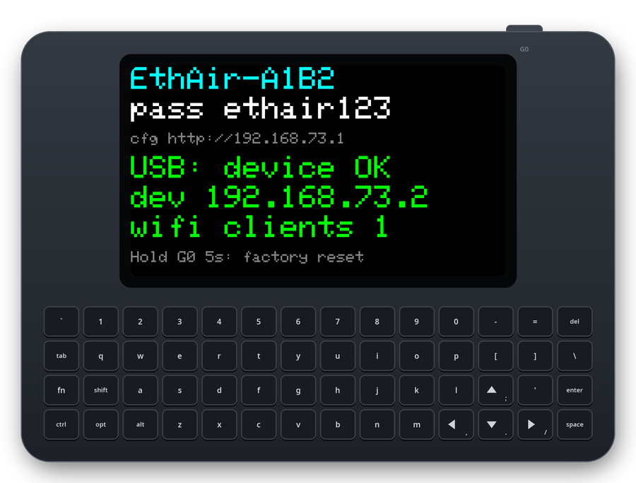
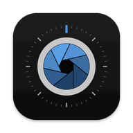
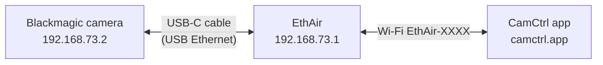
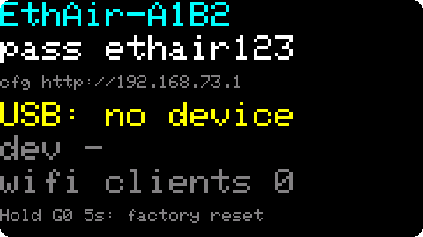
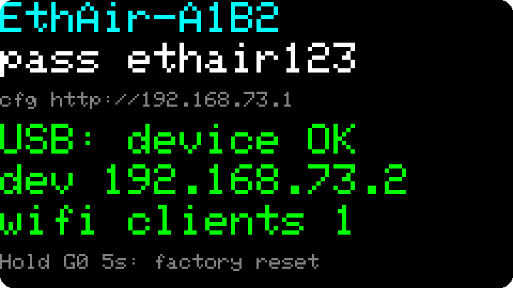
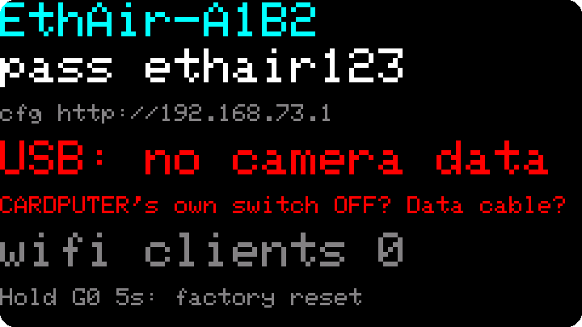

# EthAir

**A USB Ethernet adapter that bridges to its own Wi‑Fi, on an ESP32‑S3.**

Plug it into a camera (or anything with a USB host port that takes USB Ethernet adapters), join
its Wi‑Fi from a phone, and reach the device as if both were on the same switch: direct IP, mDNS
discovery, REST APIs, WebSockets. It runs from the device's own USB port. Built for the M5Stack
Cardputer and any bare ESP32‑S3 board.

<p align="center">
  
</p>

```
 camera / USB host ──USB‑C (CDC‑NCM)──▶ [ EthAir ] ◀──Wi‑Fi── phone, tablet, laptop
   192.168.73.2                         192.168.73.1           192.168.73.10–50
```

Tested with a Blackmagic Micro Studio Camera 4K G2: its REST API and mDNS name work from a phone
over Wi‑Fi.

<a href="https://camctrl.app/"></a>

**[CamCtrl](https://camctrl.app/)**, the full remote app for Blackmagic cameras<br>
<a href="https://camctrl.app/"></a>
<a href="https://camctrl.app/"></a>
<a href="https://camctrl.app/"></a>
<br clear="left">

**With a Blackmagic camera:** EthAir is the missing link for **[CamCtrl](https://camctrl.app/)**,
the full remote app for Blackmagic cameras (focus, exposure, colour, audio, media, monitoring).
The camera only offers its control API over USB Ethernet; EthAir puts it on Wi‑Fi:



Want a pocket remote on the Cardputer itself as well? See
**[CamCtrl Cardputer](https://github.com/koorchik/camctrl-cardputer)**: EthAir plus a handheld
remote UI, working side by side with the app.

## Install

### In the browser (easiest)

Open **[koorchik.github.io/ethair](https://koorchik.github.io/ethair/)** in Chrome or Edge on a
computer and follow the three steps there. Nothing to install.

### With esptool

Download `ethair-cardputer-vX.Y.Z-full.bin` (or `ethair-generic-…` for other boards) from the
[latest release](https://github.com/koorchik/ethair/releases/latest), put the board into download
mode (Cardputer: power switch off, hold **G0**, switch on, release), then:

```bash
esptool.py --chip esp32s3 write_flash 0x0 ethair-cardputer-v1.0.0-full.bin
```

Switch the board off and on again afterwards.

### M5Burner

Search for **EthAir** in M5Burner's Cardputer section (once it is published there).

## Use

1. Set the USB device's network to **DHCP**.
2. **Cardputer: set its own power switch OFF**, then plug it into the device. It runs from the
   device's USB port. (With the battery on, the Cardputer puts 5 V on the port and a Blackmagic
   camera never starts its USB host.)
3. Join the Wi‑Fi **`EthAir-XXXX`**, password **`ethair123`** (both are on the Cardputer screen).
4. The device is always at **`192.168.73.2`**. Settings: **`http://192.168.73.1`**.

| Waiting for a device | Device connected | No USB data after 15 s |
|---|---|---|
|  |  |  |

The adapter hands out **no gateway and no DNS**, so phones keep their mobile internet and a
computer on the USB side keeps its own internet.

## Settings and reset

`http://192.168.73.1/` shows the status (USB device, its IP, Wi‑Fi clients, firmware version) and
lets you change the Wi‑Fi name, password and channel. Saving restarts the adapter.

**Factory reset:** hold **G0** (or the button on GPIO0) for 5 seconds. The adapter comes back as
`EthAir-XXXX` / `ethair123`. Change the password if strangers may be nearby: it protects the
settings page too.

## Phones

- **iOS:** the app needs the *Local Network* permission.
- **Android 17+:** apps need the **Nearby devices** permission to open local addresses. Chrome
  without it fails with `ERR_TOO_MANY_RETRIES` (Settings → Apps → Chrome → Permissions → Nearby
  devices → Allow).
- **Android and "no internet" Wi‑Fi:** if Android keeps mobile data as the main network, only apps
  that bind to the Wi‑Fi (`bindProcessToNetwork`) reach the device; browsers reach it once you tell
  Android to stay on the Wi‑Fi. The adapter cannot choose this for the phone.

## Troubleshooting

| What you see | What to do |
|---|---|
| Cardputer: `USB: no camera data` | Cardputer power switch **OFF**; use a USB‑C **data** cable (not charge‑only); push the plug in firmly or flip it. |
| `dev 10.x.x.x set DHCP!` in red | The device has a static IP. Switch its network settings to DHCP. |
| Phone joined, but the page does not open | See *Phones* above (permission, mobile data). |
| Forgot the Wi‑Fi password | Cardputer: it is on the screen. Any board: factory reset. |

## Updating

From a computer or phone on the adapter's USB or Wi‑Fi network:

```bash
curl -H "X-EthAir: 1" --data-binary @ethair-cardputer-v1.0.0-ota.bin http://192.168.73.1/api/ota
```

A new image keeps its place only after it has run for 30 s and served a request; otherwise the
board rolls back to the previous version by itself.

## Under the hood

- **Layer‑2 bridge** between TinyUSB CDC‑NCM, the Wi‑Fi access point and the adapter's own lwIP
  interface, so broadcast and multicast (mDNS) pass in both directions.
- **Own DHCP server:** the USB device always gets `.2`; Wi‑Fi clients `.10–.50`; no gateway, no DNS.
- **No remote wakeup** in the USB descriptor: with it, the camera's Linux autosuspended the idle
  adapter and frames were lost. Without VBUS sensing a pulled cable looks like a bus suspend, so
  the adapter re‑attaches itself.
- **Self‑healing:** OTA with automatic rollback, restart on low memory, safe mode after two crashes
  in a row (USB becomes a serial port for 3 minutes so the board can be reflashed without buttons).
- **Optional mDNS fallback:** if a device does not answer for its own name over USB Ethernet, the
  adapter can answer for it (settings page, off by default).
- **Web security:** API calls need the `X-EthAir: 1` header and the host `192.168.73.1` (blocks
  cross‑site requests and DNS rebinding from pages the phone opens over mobile data).

### API

| Method | Path | |
|---|---|---|
| GET | `/api/status` | JSON: USB link, device IP, Wi‑Fi clients, frame counters, heap, OTA state, version |
| GET | `/api/log` | last ~8 KB of the log (there is no serial console while USB is a network card) |
| POST | `/api/ota` | body = `*-ota.bin`; update with automatic rollback |
| POST | `/api/reboot?mode=normal\|safe\|download` | restart; `safe` / `download` hand USB back for flashing |

## Building

ESP‑IDF 6.1 through PlatformIO (not Arduino: Arduino‑ESP32 2.x has no TinyUSB network class).

```bash
pio test -e native                # unit tests for the pure logic
pio run -e cardputer              # Cardputer (screen + G0)
pio run -e generic                # bare ESP32-S3, button on GPIO0
tools/flash.sh                    # build and flash: OTA if 192.168.73.1 answers, else USB serial
tools/release.sh                  # release images into dist/ (full + OTA, SHA256SUMS)
tools/publish-flasher.sh          # browser installer to GitHub Pages
```

While the firmware runs, the USB‑C port is a network card, not a serial port. To flash over USB:
`curl -X POST -H "X-EthAir: 1" "http://192.168.73.1/api/reboot?mode=safe"` (USB becomes a serial
port for 3 minutes), or the download mode by hand (power off, hold G0, power on), then
`tools/flash.sh cardputer --usb` and switch off and on again.

| Path | Role |
|---|---|
| `src/bridge.cpp` | L2 bridge: TinyUSB NCM ↔ Wi‑Fi AP ↔ lwIP |
| `src/dhcp_task.cpp`, `src/mdns_task.cpp` | DHCP server, optional mDNS fallback |
| `src/web.cpp` | settings page, JSON API, OTA |
| `src/boot_mode.cpp` | safe mode, handing USB back to serial/JTAG |
| `src/display.cpp`, `src/button.cpp` | Cardputer screen, G0 button |
| `src/logic/` | pure logic without ESP‑IDF, covered by `test/` |

Design notes: `docs/superpowers/specs/`. Screens in this README: `tools/render_screens.py`.

## Limits

- Up to 4 Wi‑Fi clients at a time; about 0.5 MB/s phone ↔ USB device.
- The factory password is the same on every adapter (so boards without a screen are usable);
  change it on the settings page.
- Tested on the Cardputer ADV. The original Cardputer has the same screen and G0 button and should
  work with the same image; other ESP32‑S3 boards with native USB use the `generic` image.
- Other USB hosts than the tested camera and Linux PCs should work if they accept class‑compliant
  CDC‑NCM adapters, but are untested.

## License

MIT, see [LICENSE](LICENSE). Third‑party parts keep their own licenses: the 5×7 font in
`src/fonts/glcdfont.h` (Adafruit, BSD), ESP‑IDF and esp_tinyusb (Apache 2.0), cJSON (MIT, test
copy in `test/support/`). ESP Web Tools (Apache 2.0) is served by the installer page.

EthAir is not affiliated with Blackmagic Design or M5Stack.
